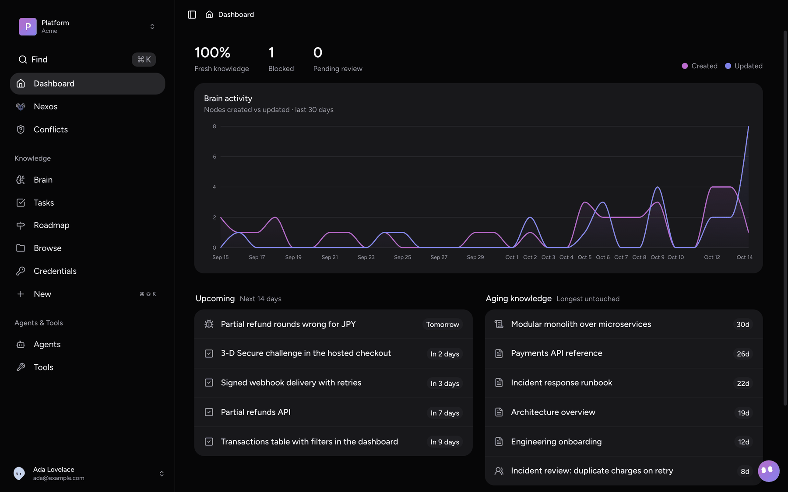
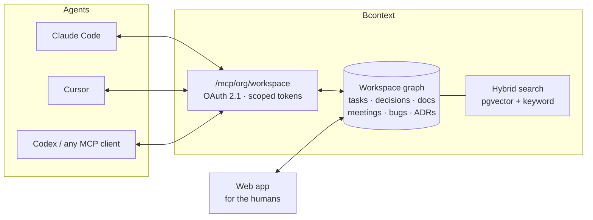
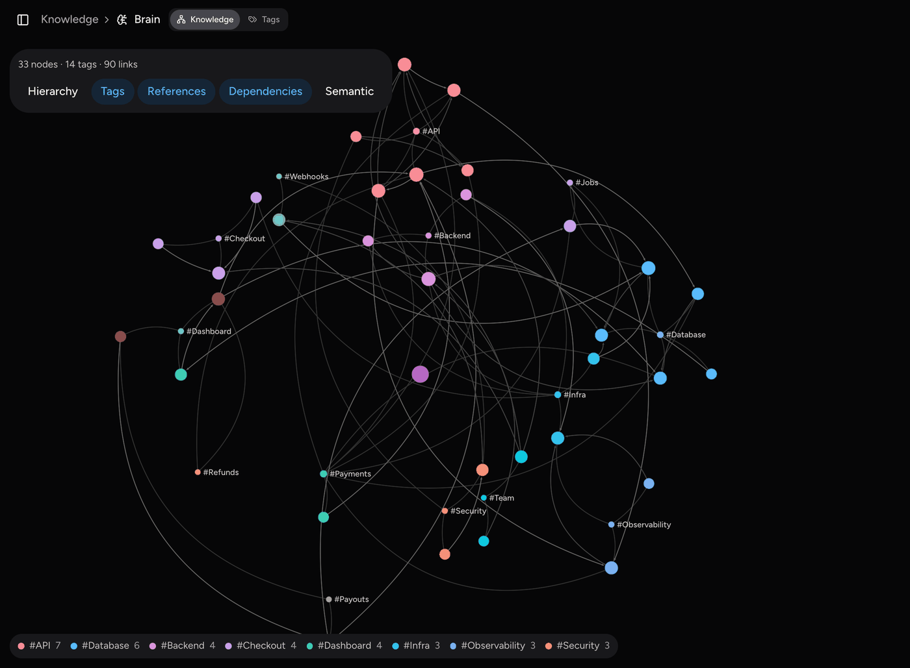
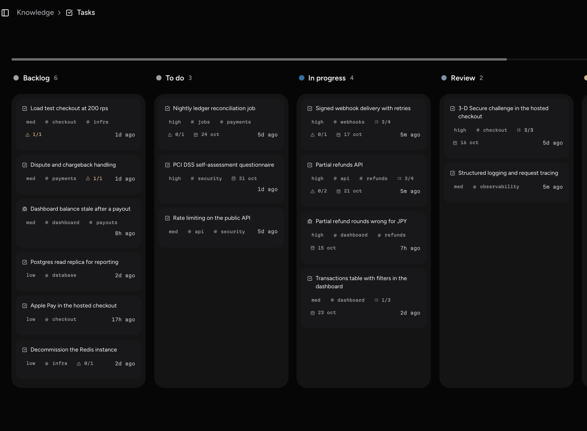
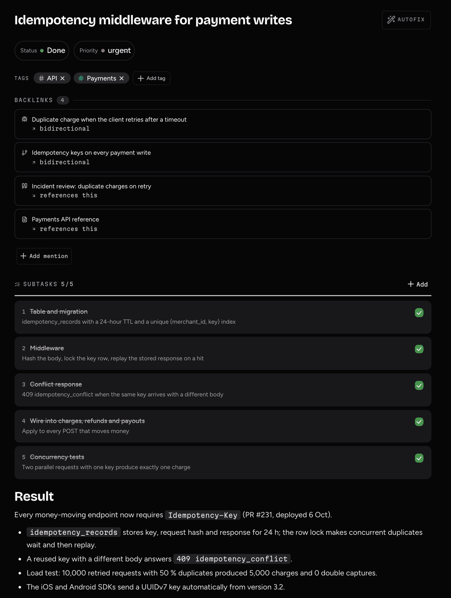
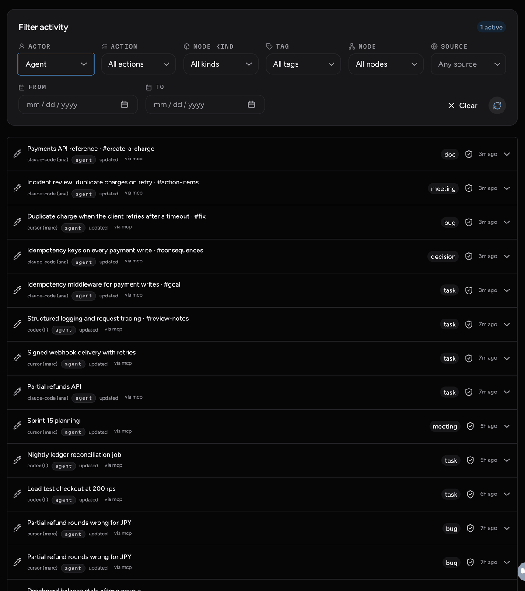

<div align="center">

<picture>
  <source media="(prefers-color-scheme: dark)" srcset="docs/images/logo-dark.svg">
  
</picture>

# Bcontext

**The shared memory your AI agents read and write.**

Tasks, decisions and docs in one workspace that Claude Code, Cursor, Codex and
your teammates all work from, over [MCP](https://modelcontextprotocol.io).
Self-hosted, open source, one `docker compose up`.

[](https://github.com/Ibonarambarri/bcontext/actions/workflows/ci.yml)
[](LICENSE)
[](docs/connect-agents.md)
[](docs/self-hosting.md)

[Quickstart](#quickstart) · [Install with an agent](docs/install-with-an-agent.md) · [Self-hosting](docs/self-hosting.md) · [Connect an agent](docs/connect-agents.md) · [Configuration](docs/configuration.md)

<br>



</div>

## Why

Your team already works with agents, and every session starts from zero.
What one agent decided on Monday lives in a chat nobody will reopen. Memory
is locked inside each tool, per person. The next agent, on someone else's
machine and a different model, contradicts last week's decision or redoes
the work.

Bcontext is the place that work lands. An agent starts by asking for a
**brief**: what is unblocked, which decisions are open, what changed since it
last looked. It picks a task, does the work and closes it with a
**`## Result`** the next agent or person builds on. People see the same graph
in the web app and steer it: review what agents wrote, fix it, decide.



## What a session looks like

```text
you   ▸ Pick up the next payments task.

agent ▸ brief()
        3 unblocked · 1 open decision · 7 changes since yesterday
        ↳ "Retry failed webhook deliveries with backoff"   todo · high
        ↳ decision "Idempotency keys on every payment write" was accepted

agent ▸ nodes_write(update, status: in_progress)
        … writes the code, honouring the idempotency decision …
agent ▸ nodes_write(append, "## Result")
        Retries use pg-boss with exponential backoff (5 attempts, max 1h).
        Dead letters land in the Ops view. PR #142.
```

Tomorrow a teammate's agent, in another editor, starts from that result
instead of from scratch.

## Features

<table>
<tr>
<td width="50%" valign="top">

**🧠 A typed knowledge graph**<br>
Tasks, decisions, ADRs, docs, meetings, bugs, entities, datasets and goals,
with typed links (`depends_on`, `supersedes`…), hierarchical tags, subtasks
and a status lifecycle. Every `##` heading is an addressable block
(`/n/<id>#result`), so agents edit one section without clobbering another.

</td>
<td width="50%" valign="top">

**🔌 An MCP server built for agents**<br>
Per-workspace endpoints, OAuth 2.1 or scoped agent tokens, and a
`tools/list` filtered to what each caller may do. Optimistic concurrency on
writes, a change feed to re-sync cheaply, and other MCP servers proxied
behind `capability_search` / `capability_call`.

</td>
</tr>
<tr>
<td valign="top">

**🔎 Retrieval that cites**<br>
Hybrid pgvector + keyword search with one-hop graph expansion. Answers
cite the nodes they came from. Works with no AI key at all (keyword search),
with the Vercel AI Gateway, or with any OpenAI-compatible server such as
Ollama or LiteLLM.

</td>
<td valign="top">

**👥 Built for teams, with an audit trail**<br>
Organizations, workspaces, invitations and per-principal grants. Every
write records who made it, person or agent, in an append-only log with a
hash chain. A collaborative editor for the humans.

</td>
</tr>
<tr>
<td valign="top">

**🤖 Nexos: the workspace's own agents**<br>
Agents that live inside a workspace with a shared brain: an inbox, a
heartbeat, a monthly budget and a chat. They triage, flag contradictions
between decisions and answer questions about the workspace.

</td>
<td valign="top">

**🔗 Integrations**<br>
Native connectors for GitHub, Slack, Linear and Notion, plus a long tail
through a self-hosted [Nango](https://nango.dev). What they bring in is
extracted into candidates in a review inbox, accepted by a person or
auto-accepted above a confidence threshold you set.

</td>
</tr>
</table>

## Screenshots

<table>
<tr>
<td width="50%"><br><sub><b>Graph.</b> How tasks, decisions and docs connect.</sub></td>
<td width="50%"><br><sub><b>Board.</b> Tasks by status, with subtask progress.</sub></td>
</tr>
<tr>
<td><br><sub><b>A task.</b> Subtasks and the <code>## Result</code> an agent left behind.</sub></td>
<td><br><sub><b>Changes.</b> Who wrote what, person or agent.</sub></td>
</tr>
</table>

## Quickstart

### Let your agent install it

Paste this into Claude Code, Codex, Cursor or any agent with a shell:

```text
Install Bcontext (https://github.com/Ibonarambarri/bcontext) on this machine.
Follow https://raw.githubusercontent.com/Ibonarambarri/bcontext/main/docs/install-with-an-agent.md
step by step: clone or update the repo, configure it, start it, wait until it
is healthy, then connect yourself to my workspace over MCP. Ask me only for
what you cannot decide.
```

It checks Docker, asks where it should run and your email, writes the
configuration, starts the stack and, once you have created your account,
connects itself over MCP. The steps it follows are in
[docs/install-with-an-agent.md](docs/install-with-an-agent.md).

### Or by hand

You need Docker with Compose v2, `openssl` and about 4 GB of free RAM to build
(the running stack uses under 1 GB).

```bash
git clone https://github.com/Ibonarambarri/bcontext.git && cd bcontext
./setup.sh --domain localhost --admin-email you@example.com -y
docker compose up -d
```

Open <http://localhost>, create your account and organization at `/start`,
and you're in. The first `up` builds the images from source when no release
image is available, which takes a few minutes. Port 80 taken? Add
`--http-port 8080` to `setup.sh`.

On a server with a real domain, Caddy gets the HTTPS certificate
automatically: see [docs/self-hosting.md](docs/self-hosting.md) for DNS, email,
AI keys, backups and updates.

## Connect your agent

In the web app, **Agents → Add agent** gives you a ready-to-paste snippet for
each client. For Claude Code by hand:

```bash
claude mcp add --transport http bcontext https://your-host/mcp/<org>/<workspace>
```

Claude Code opens the browser to approve the connection (OAuth). For the
plugin, which adds the working conventions as a skill and a
`/bcontext:brief` command, and for Cursor, Codex and token auth, see
[docs/connect-agents.md](docs/connect-agents.md).

## Architecture

<details>
<summary>One <code>docker compose</code> project on one machine. Caddy is the only service with published ports.</summary>

<br>

| Service | What it runs |
|---|---|
| `caddy` | A single origin for everything: the web app, the API, `/mcp` and the Supabase gateway, with automatic HTTPS |
| `web` | The Next.js app (`apps/web`). It has no data of its own and calls the API over HTTP |
| `api` | REST, the MCP server and realtime WebSockets (`apps/api`) |
| `worker` | pg-boss queues: webhooks, connector syncs, Nexo runs, retention (same image as `api`) |
| `migrate` | One-shot: applies pending migrations, then exits; `api` and `worker` wait for it |
| `db` | Postgres 15 with pgvector (`supabase/postgres`) |
| `auth`, `rest`, `storage`, `kong` | Supabase Auth, PostgREST, Storage (files on a volume) and its gateway |
| `errors` *(profile)* | Optional error collector behind `/admin/errors` |
| `studio`, `meta` *(profile)* | Optional Supabase Studio on `127.0.0.1` |

```
apps/api            API, MCP server, worker, error collector, migrations (one image)
apps/web            Next.js web app
packages/contract   types and helpers both apps share
deploy/             Caddyfile, Supabase gateway and init SQL, migration runner
plugin/             Claude Code plugin: conventions skill and /bcontext:brief
docker-compose.yml  the self-hosted stack
setup.sh            writes .env with fresh secrets
```

**Stack:** TypeScript · Hono · Next.js 16 · React 19 · Postgres + pgvector ·
Supabase Auth/Storage · pg-boss · Vercel AI SDK · HeroUI · Caddy

</details>

## Project status

Bcontext started as a commercial product and is now released as open
source for anyone who wants to run it. It ran in production and works end
to end, but it is maintained on a best-effort basis: issues and pull requests
are welcome, and there are no response-time promises. Start with
[CONTRIBUTING.md](CONTRIBUTING.md). Agents working on the codebase, start
with [AGENTS.md](AGENTS.md).

## License

[GNU Affero General Public License v3.0](LICENSE) (`AGPL-3.0-only`). You can
use, modify and self-host it freely. If you run a modified Bcontext as a
network service, you must offer its source to its users.
